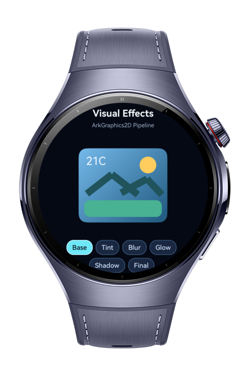
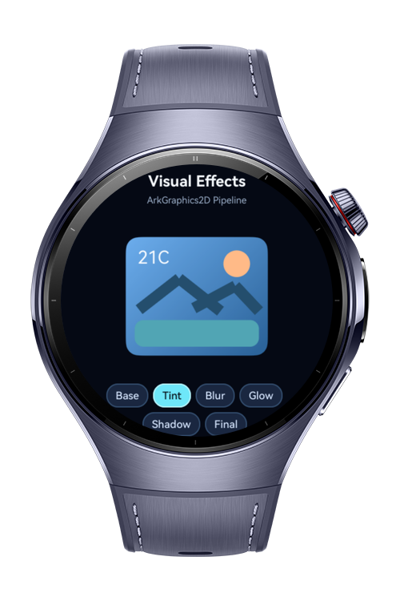
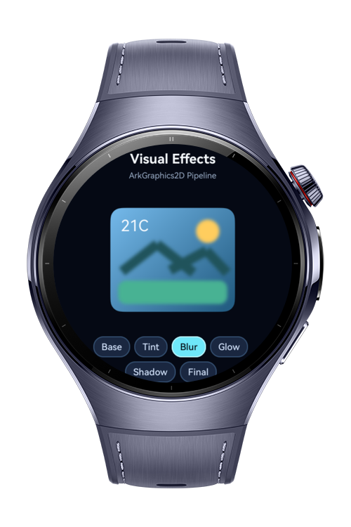
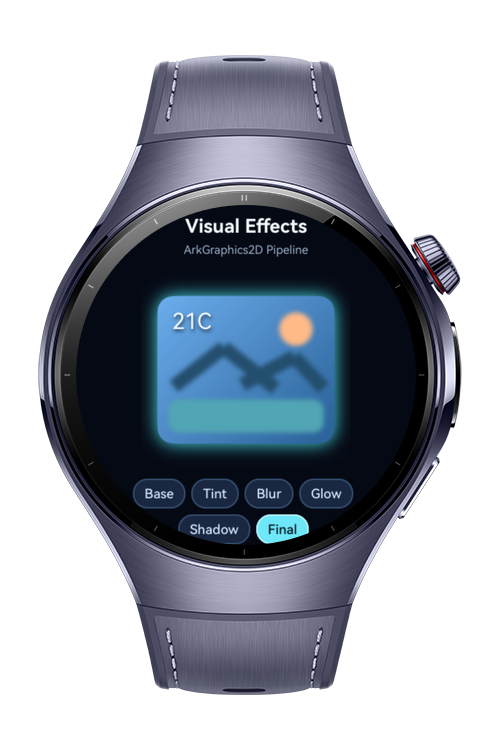

> **Note:** To access all shared projects, get information about environment setup, and view other guides, please visit [Explore-In-HMOS-Wearable Index](https://github.com/Explore-In-HMOS-Wearable/hmos-index).

# How to Build Visual Effects Pipeline

How to Build Visual Effects Pipeline is a HarmonyOS NEXT wearable codelab that demonstrates a compact ArkGraphics2D image-effects compositor using shaders, color filters, image filters, mask glows, and text shadows on a round watch screen.

# Preview

<div>




</div>

# Use Cases

- Build a watch-friendly custom drawing surface with `RenderNode`, `NodeController`, and `NodeContainer`.
- Demonstrate `ShaderEffect` with a gradient-filled tile surface.
- Apply `ColorFilter` matrix tinting to recolor artwork without replacing the source drawing.
- Use `ImageFilter` to blur a grouped artwork layer while keeping the tile position fixed.
- Add a `MaskFilter` halo around the tile edge without introducing a separate frame.
- Show `ShadowLayer` on existing `TextBlob` reading text, where the API is actually visible.
- Compare `Base`, `Tint`, `Blur`, `Glow`, `Shadow`, and `Final` stages from compact wearable chips.

# Tech Stack

Languages: ArkTS
Frameworks: HarmonyOS SDK 6.0.1(21)
Tools: DevEco Studio / hvigor build flow
Libraries/Kits: `@kit.ArkUI`, `@kit.ArkGraphics2D`, `@kit.AbilityKit`, `@ohos.hypium`
 
# Directory Structure

```
entry/src/main/ets/
|---components
|---|---EffectExplanation.ets
|---|---EffectsPreview.ets
|---|---StageChip.ets
|---entryability
|---|---EntryAbility.ets
|---entrybackupability
|---|---EntryBackupAbility.ets
|---model
|---|---EffectSettings.ets
|---|---EffectStage.ets
|---pages
|---|---Index.ets
|---render
|---|---EffectsPipeline.ets
|---|---VisualEffectsNodeController.ets
|---|---VisualEffectsRenderNode.ets
```

# Constraints and Restrictions

## Supported Devices

- Huawei Watch 5

# LICENSE

How to Build Visual Effects Pipeline is distributed under the terms of the MIT License.
See the [LICENSE](/LICENSE) for more information.
